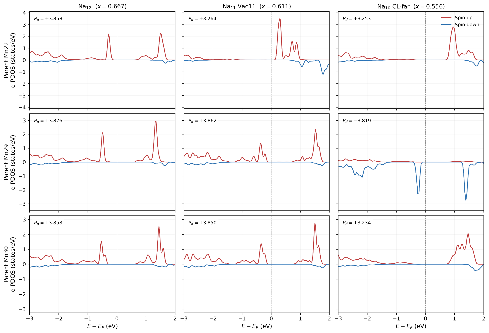
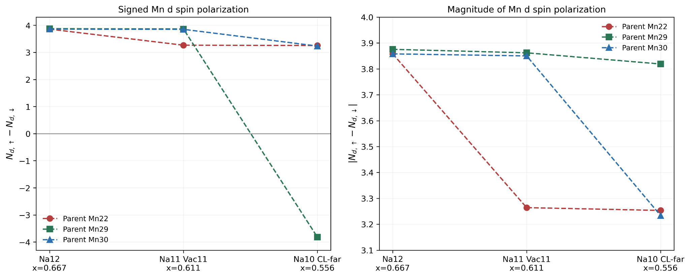
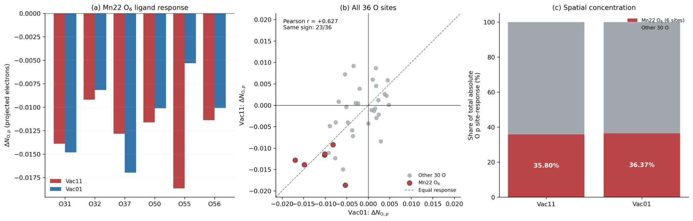

# Figures A–C: validated electronic-structure checkpoint

## Figure A. Site-resolved Mn d projected DOS

**Caption.** Spin-resolved Mn d projected density of states for selected P2-Na$_x$Fe$_{0.5}$Mn$_{0.5}$O$_2$ structures ($x=0.667$, 0.611, 0.556), obtained under matched PBE+U+D3 static settings. Rows track parent Mn22, Mn29 and Mn30; columns correspond to the Na12 parent, Na11 Vac11 and Na10 CL-far configurations. Spin-down DOS is displayed below zero by convention; positive-energy features above each calculation's $E_F$ are unoccupied. The configurations do not define a unique nested Na-vacancy extraction path.

## Figure B. Signed and absolute Mn d spin polarization

**Caption.** Signed and absolute integrated Mn d spin polarizations for three matched physical Mn sites across selected Na compositions. Mn22 shows its main magnitude reduction in the Na12–Na11 comparison; Mn30 shows its main reduction in the Na11–Na10 comparison. Mn29 reverses spin sign in the Na10 CL-far solution while preserving a large absolute polarization. Dashed line segments are guides to the eye between discrete calculations, not a continuous reaction trajectory.

## Figure C. Site-resolved oxygen-ligand response

**Caption.** Site-resolved occupied O p projection changes in Na11 Vac11 and Na11 Vac01 relative to the Na12 parent. (a) Changes for six oxygen ligands around parent Mn22. (b) Comparison across all 36 oxygen sites, highlighting the Mn22 O6 shell. (c) Relative contribution of the Mn22 shell to the sum of absolute oxygen-site projected population changes. All six Mn22 ligands show decreasing occupied O p projection in both configurations; the six-site shell comprises ~16.7% of oxygen sites but ~36% of absolute response. This is not a measured redox-charge fraction.

## Provenance and limitations

The figures shown here were generated on research storage using the project-specific extraction scripts and reviewed visually in their v2/v1 versions. **PNG copies are included in Git for convenient browsing; original vector PDFs, analysis scripts and VASP output files remain on research storage.** See [reproducibility](reproducibility.md) for paths relative to the research project and source data boundaries.
